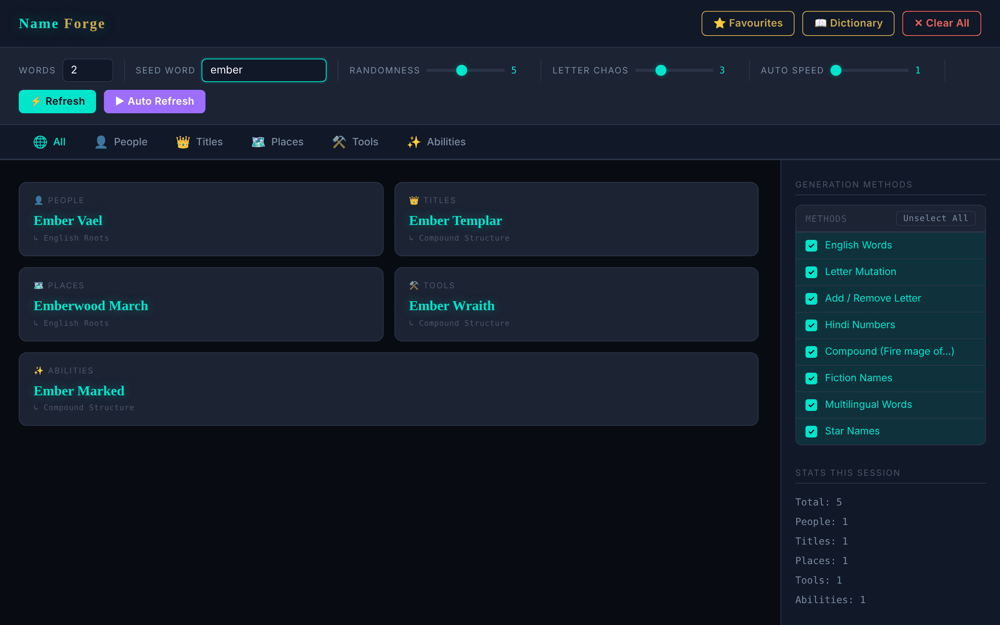
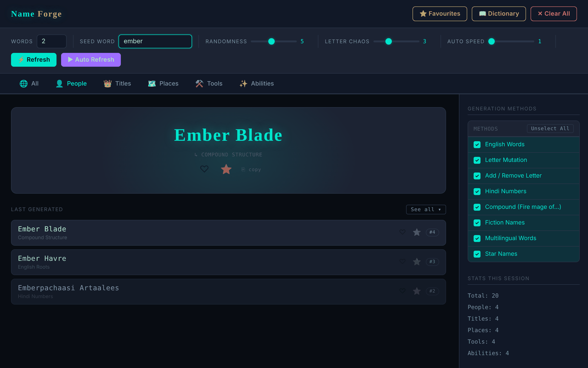

# Name Forge
> Writers and worldbuilders can get name inspiration in one click, guided by the methods and options they choose, without the tedium of inventing every name from scratch.

**Try it:** [dvynsh3.github.io/Name-Forge](https://dvynsh3.github.io/Name-Forge/)  ·  **Status:** Active  ·  **Platform:** Browser (single HTML file, works offline)

<!-- SCREENSHOT: hero -->

## Why this exists
- **Who:** Writers and worldbuilders, including people who keep their notes in Obsidian.
- **Before:** Thinking up new names is tedious, and starting from a blank page stalls the writing.
- **Now:** The tool offers raw material rather than finished answers. You choose the generation methods and options, then read what comes out as a spark for a name of your own. It can also give you a usable name, but the aim is to help you come up with it yourself. Nothing is sent anywhere.

## What it does
**Generate**
- Generate names for people, titles, places, tools and abilities at once, each in its own tab, plus an All tab.
- Steer results with a seed word, a word count (1 to 5), and sliders for randomness and letter chaos.
- Choose which of eight methods are used: English roots, letter swaps, add or remove a letter, Hindi number words (1 to 100), compound structures such as "Fire Mage of Thornfield", fiction-style names, multilingual words (10 languages) and real star names.

**Browse**
- Keep names flowing with Auto Refresh (adjustable speed) or the Spacebar; the last three names stay visible and "See all" lists everything from the session.
- Copy any name with one click.
- Inspect every stored word pool in the Dictionary.

**Keep**
- "Like" names so "Related Names" suggestions lean towards them (session only).
- Save favourites and download them as Markdown table rows, with a filename and vault-folder hint you choose.

<!-- SCREENSHOT: key flow -->

## Quick start
1. Open the [live page](https://dvynsh3.github.io/Name-Forge/), or download `index.html` from [Releases](../../releases) and open it in any modern browser.
2. Press **Refresh** (or Space).
3. Type a word such as `ember` into **Seed Word** and refresh again.
4. Result: each tab shows a new name built around your word. Letter-based methods may alter it slightly.

## Decisions and trade-offs
| Decision | Over | Because |
|---|---|---|
| Rule-based generation from stored word pools | AI or online name services | Offline workflow with options for local file storage for favourites. |
| All five name types generated together | One type at a time | The recent history can be glanced at with new group of names by switching tabs. |
| Seed word used by every method | Using it only some of the time | Version 1 applied it inconsistently; version 2 fixed that |
| Likes kept for the session; favourites exported | Saving likes too | Likes only steer suggestions; favourites are the keepers |
| Favourites downloaded as Markdown rows | Writing straight into a vault folder | A web page cannot write to arbitrary folders |
| One self-contained HTML file | An app or backend | Using it offline inside Obsidian was most convenient with a single file |

**What I left out on purpose:**
- Phonetic scoring and syllable control.
- Name templates, tags and undo.
- Light theme and per-faction naming rules.

## Known limits
- Favourites, likes and history are held in memory and are lost when the page is reloaded.
- Favourites are downloaded, not written into your vault. The first download after each page load includes the table header, so pasting a later session's first download into an existing table will duplicate the header.
- With a seed word, letter swaps and add/remove alter it by design. At a word count of 1, some Title names drop the seed word.
- Repetition avoidance retries up to 8 times, so a repeat is still possible in small pools.
- Space refreshes only when focus is not in a text or number field.
- Display fonts load from Google Fonts; offline, the page falls back to system fonts.

## Privacy and data
- Runs entirely in your browser: no server, account, cookies, analytics or browser storage.
- The only network request is the Google Fonts stylesheet on load, which reveals your IP address to Google.
- Names, likes and favourites exist in memory only. Favourite downloads are created locally on your device.

## Evidence
No usage numbers collected so far.

## Version history
Latest: **v0.4.0** (2026-11-26). Full detail in [CHANGELOG.md](CHANGELOG.md) and [Releases](../../releases).
| Version | Date | What changed for the user |
|---|---|---|
| v0.1.0 | 2026-06-29 | First build: five name types, five methods, seed word, auto refresh, dictionary |
| v0.2.0 | 2026-08-02 | Selectable method list, seed always used, All tab, full session history |
| v0.3.0 | 2026-09-04 | Add/remove letter method, multilingual words (10 languages), slower default auto speed |
| v0.4.0 | 2026-11-26 | Favourites export, likes and related names, Spacebar, repetition avoidance, star names, renamed to Name Forge |

Earlier versions are archived builds restored from local backups; the source at each tag is the repository snapshot at upload, not the original code for that version.

## Feedback
Report problems or ideas in [Issues](../../issues). Useful details: browser and version, the method badge shown under the name, and the steps that led to it.

## How this was built
I designed and specified the tool, directed the build, tested each version and decided what to keep or cut. Claude (Anthropic) wrote much of the implementation. The generator itself uses no AI.

## Credits
- Fonts: Cinzel, Share Tech Mono and Inter via Google Fonts.
- Fiction-style names belong to their authors and rights holders and are used only as naming inspiration. Star names are real astronomical names.

## Licence
MIT. See [LICENSE](LICENSE). Copyright (c) 2026 dvynsh3.
